# GateKeeper

a small team reviews pull requests for logic, not security, so one hardcoded password can slip into main and stay in git history.

GateKeeper scans every pull request in the cloud with the SAST scanner and posts the result on the exact commit.
a HIGH finding blocks the merge until a fix commit passes, and a scan that can not check everything blocks it too.
it runs on AWS with API Gateway, Lambda, SQS, DynamoDB and S3, built with Terraform.

## Our App
- every pull request in our demo repo gets scanned by the SAST scanner on AWS
- a HIGH finding gives commit status `failure`, so the merge is blocked
- a scan that could not check everything gives `error`, so it is blocked too (not checked is not safe)
- after 5 failed tries the PR gets `error` with a Details link to our page
- a public Paste and Scan page: paste JavaScript, get the same check, read a masked report

## Paste and Scan page
- Code Scanner: paste code or load an example, type the access code, run the scan
- Scan through AWS: 8 boxes (write path and read path) light up from the real job phase (not a health monitor)
- Scan Activity: received, queued, scanning, report, try n of 5, and the calls the page made
- Security Report: PASS, FAIL or INCOMPLETE, HIGH, MEDIUM and LOW, masked findings, share link
- Recent PR Checks: newest 20 PR scans of the demo repo (pastes never show here)
- no fake numbers: every value comes from our API or the job record
- open a .js file: read in the browser, sent only when you scan
- every log line shows the real request time from your browser, and a routes table shows the real rate limits

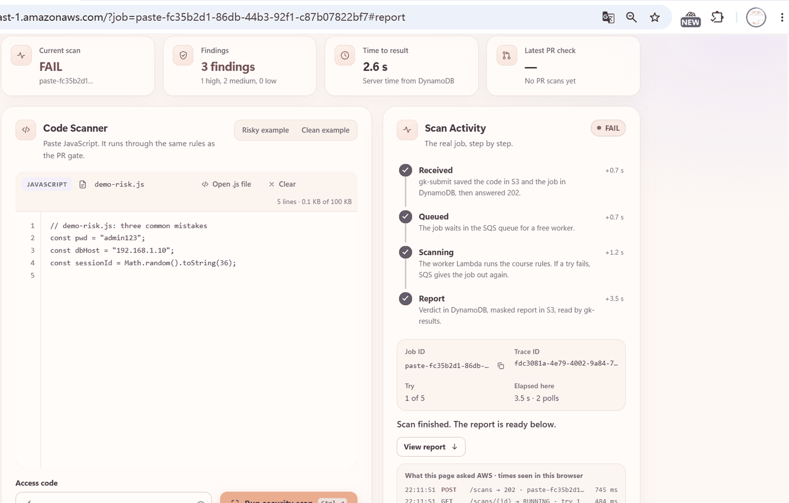

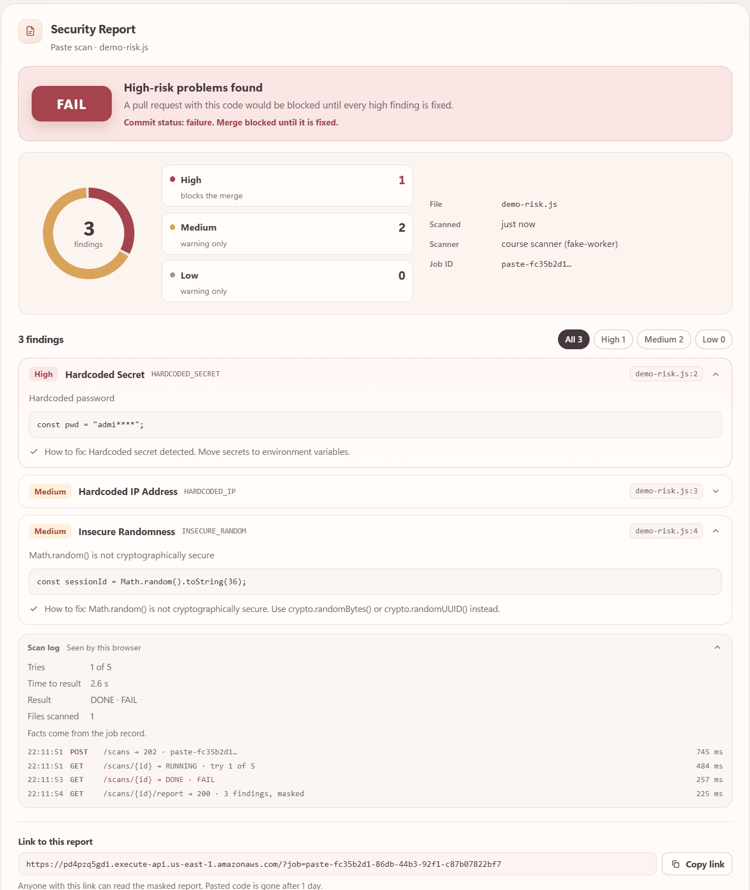

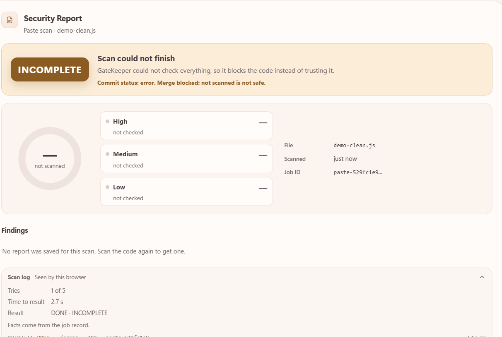

## architecture

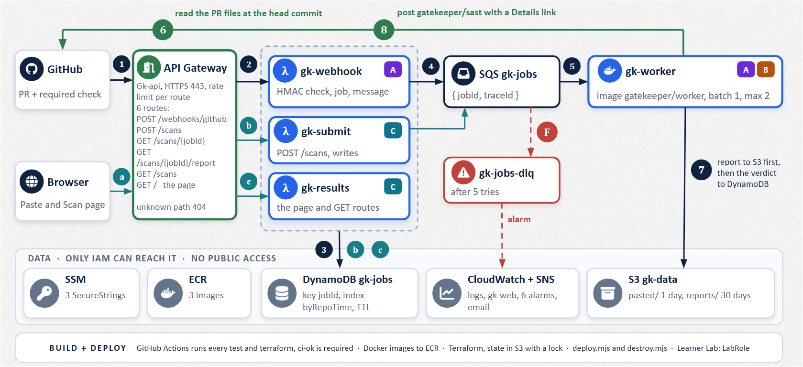

one pull request (the numbers in the picture):
1. GitHub sends a signed webhook to API Gateway `gk-api`
2. API Gateway gives it to `gk-webhook`
3. `gk-webhook` checks the HMAC and saves the job in DynamoDB `gk-jobs` as QUEUED
4. it puts `{ jobId, traceId }` on SQS `gk-jobs` and answers 202
5. SQS starts `gk-worker`, batch size 1, at most 2 at once, and the worker takes a 90 s lease
6. the worker reads every .js .mjs .cjs .ts file at the head commit (up to 50, each up to 256 KB)
7. it saves the report in S3 `reports/` first, then the verdict and counts in DynamoDB
8. it posts `gatekeeper/sast` on the commit with a Details link to our page

paste path (a b c): `GET /` loads the page from gk-results, `POST /scans` goes to gk-submit (same queue, same worker),
then the page polls `GET /scans/{jobId}` and reads `GET /scans/{jobId}/report`.

failure path (F): a failed try comes back after 6 min, after 5 tries the job goes to `gk-jobs-dlq`, the PR gets `error`
and the alarm `gk-dlq-not-empty` emails the team.

## AWS names
| AWS part | name | what it holds |
| --- | --- | --- |
| API Gateway | `gk-api` | 6 routes, a rate limit on every route, any other path gets 404 |
| Lambda | `gk-webhook` `gk-worker` `gk-submit` `gk-results` | one per part, all run as LabRole in Learner Lab |
| SQS | `gk-jobs` and `gk-jobs-dlq` | visibility 360 s, kept 4 days, after 5 tries the job goes to the dead letter queue (14 days) |
| DynamoDB | `gk-jobs` | one item per job, key `jobId`, index `byRepoTime`, TTL on `expiresAt` |
| S3 | `gk-data-<account>` | `pasted/` (1 day) and `reports/` (30 days), no public access, HTTPS only |
| SSM Parameter Store | `/gatekeeper/demo-code` `/gatekeeper/github-token` `/gatekeeper/webhook-secret` | SecureString, never in code or git |
| ECR | `gatekeeper/web` `gatekeeper/webhook` `gatekeeper/worker` | one image per part, the tag is the git SHA |
| CloudWatch | dashboard `gk-web` and 6 alarms | JSON logs with the jobId and traceId in every line |
| SNS | `gk-alerts` | the alarms email the team |

job fields: `jobId` `source` `repo` `prNumber` `headSha` `phase` `verdict` `counts` `attempt` `leaseOwner` `leaseUntil` `reportKey` `codeKey` `traceId` `createdAt` `updatedAt` `expiresAt`

route limits (all with burst 5):
| route | function | limit |
| --- | --- | --- |
| `POST /webhooks/github` | gk-webhook | 5 per second |
| `GET /` | gk-results | 2 per second |
| `POST /scans` | gk-submit | 1 per second |
| `GET /scans` | gk-results | 2 per second |
| `GET /scans/{jobId}` | gk-results | 5 per second |
| `GET /scans/{jobId}/report` | gk-results | 2 per second |

## one real run on AWS
all pictures below are from one lab session in one Learner Lab account, one request at a time. the console top bar is
cut off and account IDs are covered.

### 1 deploy the web part from zero
- `node scripts/gk/deploy.mjs --part web` builds the image, pushes it to ECR and runs Terraform: 29 resources
- smoke test 10 of 10, and 11 of 11 with the access code (a real scan gets 202)
- 3.2 min from the start to the end of both smoke tests

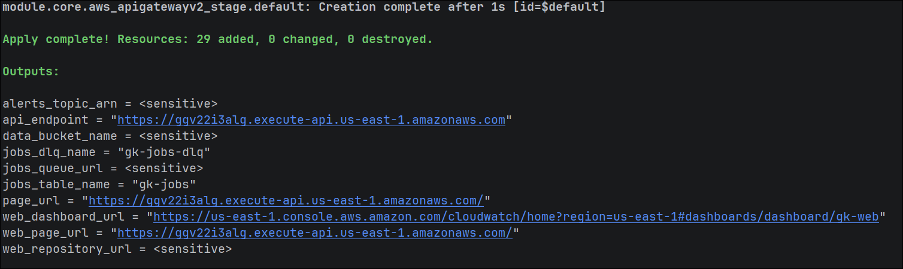

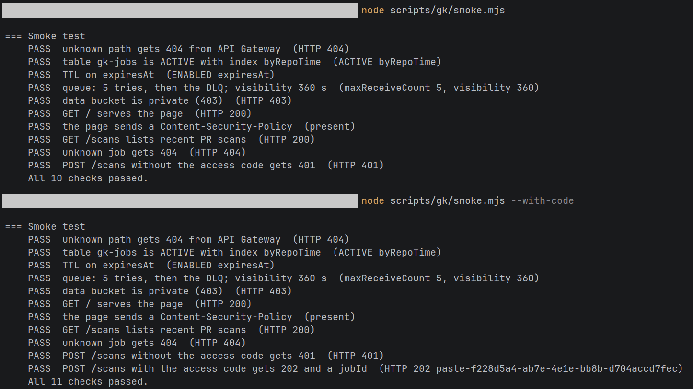

### 2 add the team parts
- one more command: `node scripts/gk/deploy.mjs --part intake --part worker --part web --repo vickyliuwt/gatekeeper-demo`
- 9 more resources (gk-webhook, gk-worker, the SQS trigger, 2 ECR repos, the webhook route, 3 alarms), 38 in total
- the worker gets jobs from SQS `gk-jobs` with batch size 1 and at most 2 at once (our safety line)

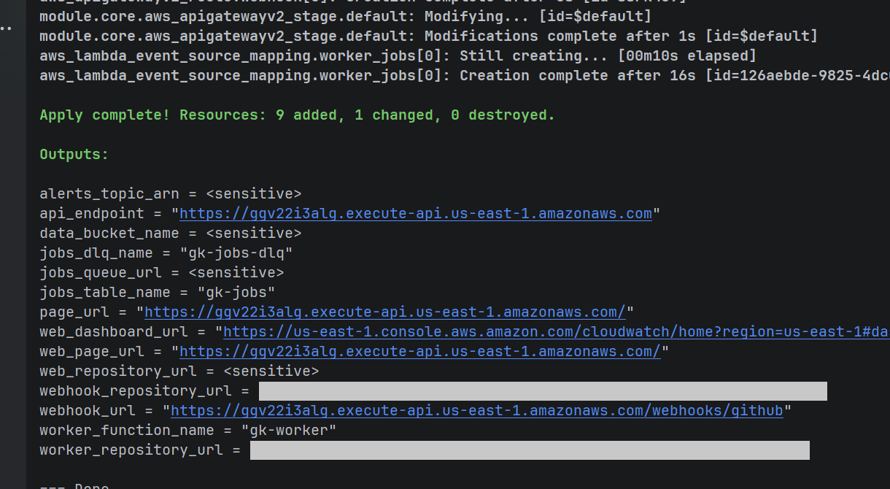

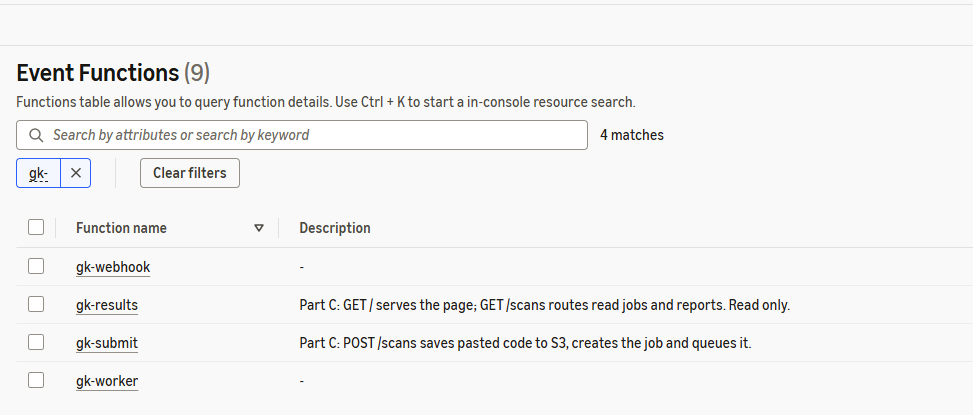

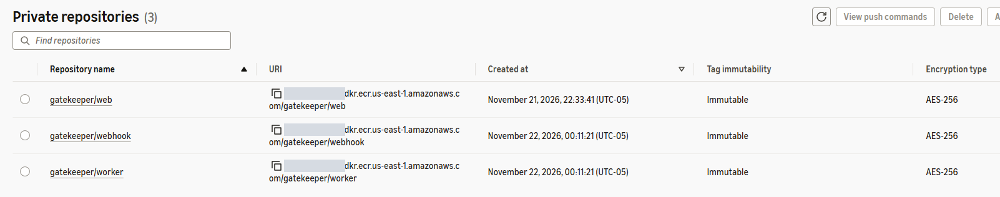

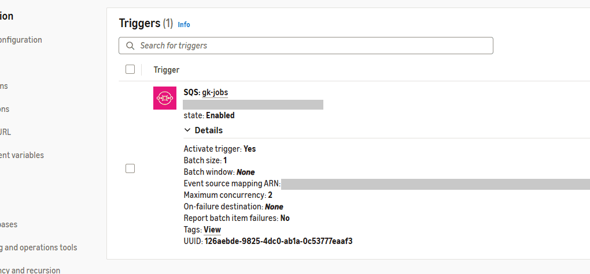

### 3 one job through SQS, DynamoDB and S3
- with no worker running the job waits in SQS, so nothing gets lost
- after the worker: phase DONE, attempt 1, the report key points to S3 `reports/`
- a scan that can not finish ends INCOMPLETE with no report

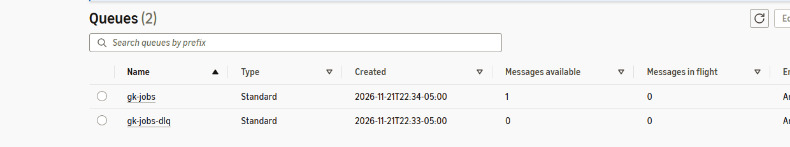

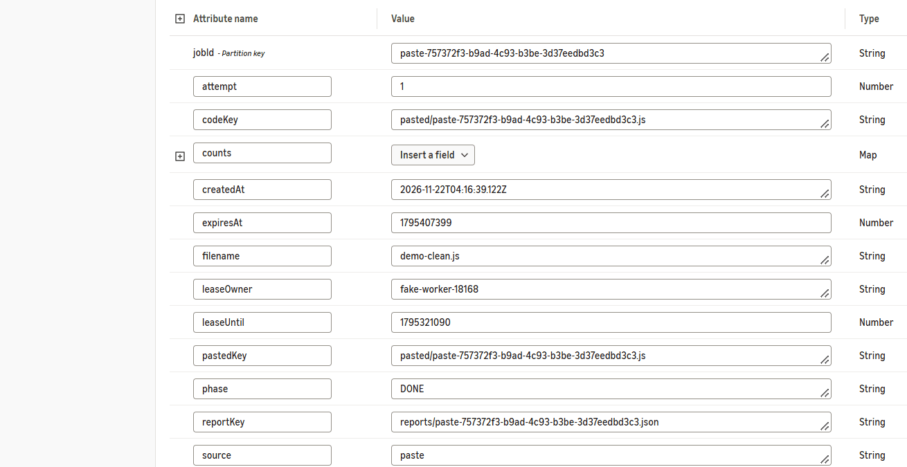

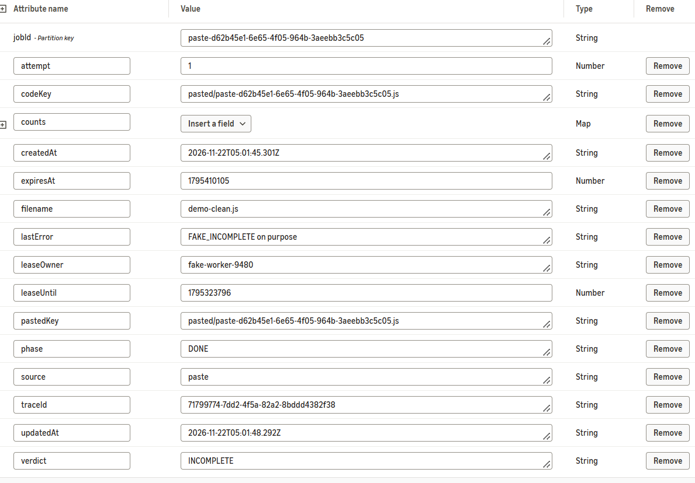

### 4 the real PR gate
- PR #7 in our demo repo adds `const dbPassword = "demo1234";`
- commit 373da2c: `gatekeeper/sast` failure, Scanned 2 files: 1 HIGH, 0 MEDIUM, 0 LOW. merge blocked
- fix commit 83fce95: success. each job took about 4 s from created to verdict (3.8 s and 4.0 s)
- gk-webhook answered the delivery with 202 and the jobId (GitHub shows 0.46 s), a ping got 200, a wrong signature got 401

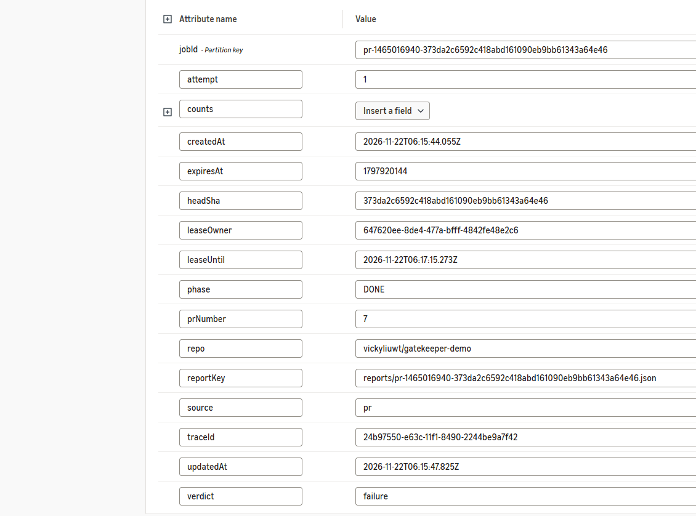

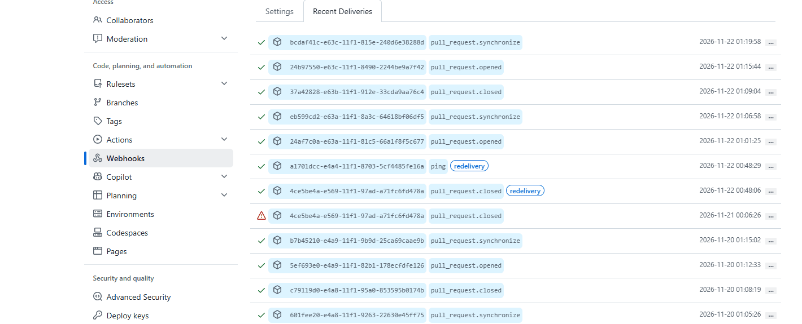

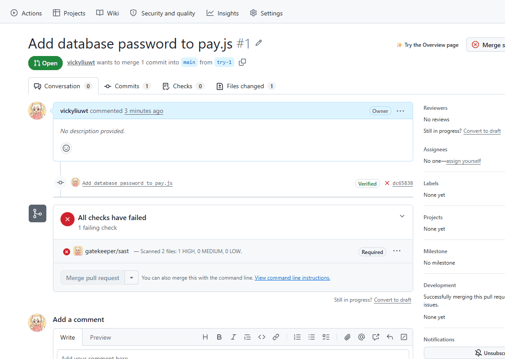

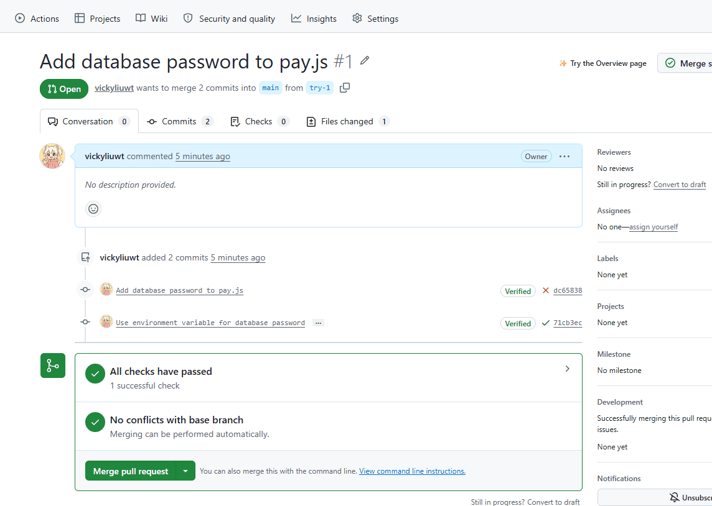

### 5 watch it
- 6 alarms, all OK after the demo
- dashboard gk-web in that hour: 54 job polls, 7 scans, 7 reports, 8 page loads, peak 2 Lambdas, no error lines
- peek-job follows one jobId through the item, the counts and every log line. this paste took 1.8 s from created to done

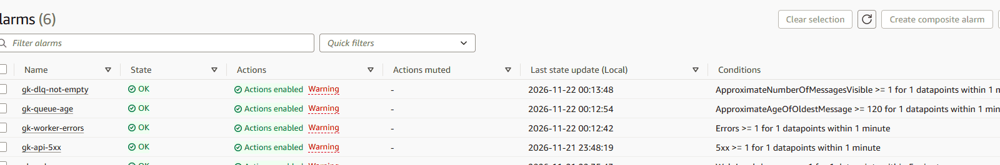

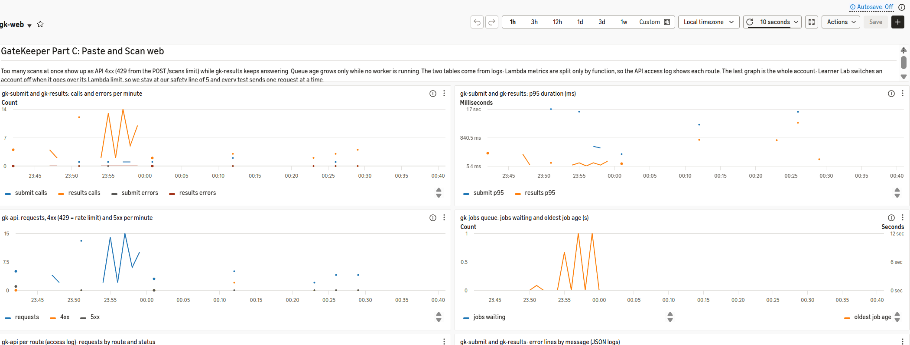

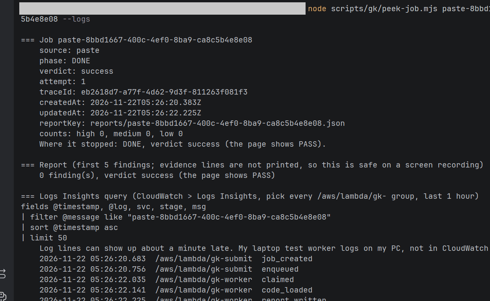

### 6 destroy
- `node scripts/gk/destroy.mjs`: 41 destroyed, then a check says nothing from GateKeeper is left
- kept on purpose: the Terraform state bucket and the 3 SSM values
- the whole session peaked at 2 Lambdas at once

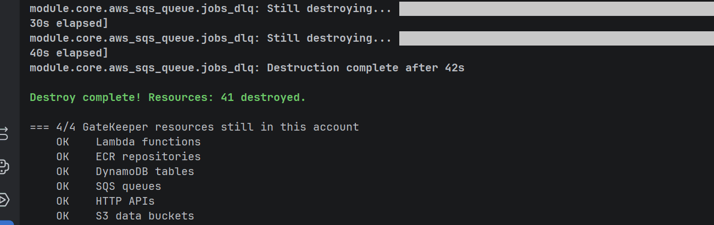

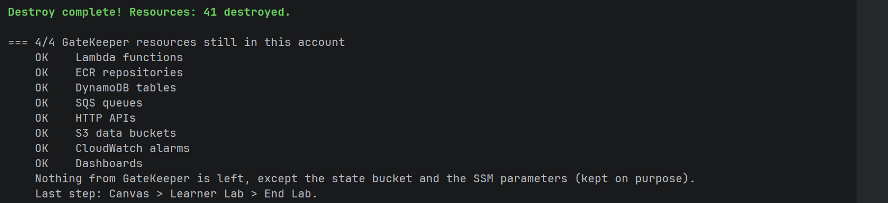

## results (real runs) and where the proof is
| what | result | proof |
| --- | --- | --- |
| webhook tests | 35 / 35 | `services/webhook/test`, CI job webhook |
| webhook reply time (20 deliveries) | p95 1.80 s, max 1.88 s | `docs/part-a-validation.md` |
| Part A rebuild from zero | 20 min 52 s | `docs/part-a-validation.md` |
| worker tests | 34 / 34 | `worker/test`, CI job worker |
| Part C tests (page, 2 functions, the real worker fit) | 236 / 236, self-scan HIGH 0 | `services/web/test`, `services/web/scripts/self-scan.js` |
| scripts/gk tests | 34 / 34 | `scripts/gk/test` |
| real PR gate (PR #7) | 1 HIGH found and the merge blocked, the fix commit passed, about 4 s each | pictures in part 4 |
| web part from zero | 29 resources, 3.2 min with both smoke tests, smoke 10 / 10 and 11 / 11 | pictures in part 1 |
| team parts added | 9 more, 38 in total, smoke 11 / 11 | pictures in part 2 |
| destroy | 41 destroyed, nothing left that bills by the hour | pictures in part 6 |
| Lambdas at once, the whole lab session | peak 2 (our alarm line is 5) | dashboard picture |
| paste to result, 10 scans one after another, team worker | p50 0.67 s, p95 1.30 s | picture below |
| live checks (headers, 404, 401, a real scan) | 14 / 14 | picture below |
| scanner false alarms on the course files scanner.js and server.js | 87 to 20, test-vulnerable.js still 36 found | `worker/baseline` and `worker/after-fix4` |
| a 32 KB hostile file | 52.8 ms with the old scanner, 0.2 ms with the fixed one (on a laptop) | `worker/test/scanner.test.js` checks under 100 ms |
| forced worker failure | page shows try 1 of 5 failed, then the result | `worker/test/last-try.test.js` for try 5 |
| cost | GateKeeper itself about 0 | Learner Lab budget |

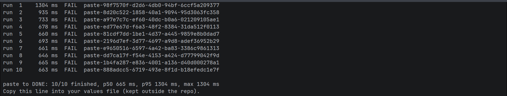

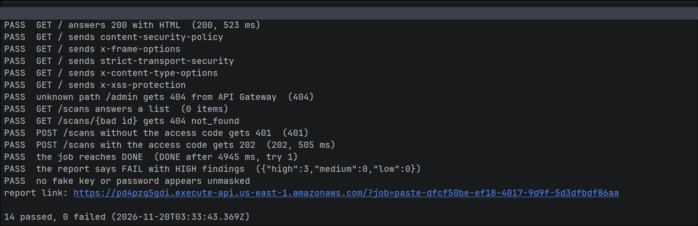

## where things are
| part | files |
| --- | --- |
| the page | `services/web/public/index.html` `app.js` `logic.js` `style.css` |
| gk-submit and gk-results | `services/web/src/submit.js` `results.js` `page.js` `mask.js` `validate.js` `gateway.js` `lambda.js` `aws.js` |
| gk-webhook | `services/webhook/src/signature.js` `intake.js` `job.js` `store.js` `queue.js` `lambda.js` |
| the worker | `worker/src/handler.js` `pr-source.js` `github-status.js` `github-token.js` |
| the scanner | `sast/backend/scanner.js` (course scanner and our fixes) |
| Terraform | `infra/core.tf` `web.tf` `webhook.tf` `worker.tf` `alerts.tf`, modules in `infra/modules/core` and `infra/modules/web` |
| deploy tools | `scripts/gk/deploy.mjs` `destroy.mjs` `smoke.mjs` `peek-job.mjs` `demo-code.mjs` |
| CI | `.github/workflows/ci.yml` (ci-ok) `webhook-ci.yml` `worker-ci.yml` `web-image.yml` |
| IAM for a real account | `docs/iam/gk-submit.json` `docs/iam/gk-results.json` |
| local run of all parts | `docker-compose.yml` |

## CI and main
- every pull request runs `.github/workflows/ci.yml`: the tests of every part and a terraform check, then `ci-ok`
- main has a ruleset `protect-main`: a pull request with `ci-ok` green, merge commits only, no force push, no delete
- every part came into main through an int branch first, then one pull request

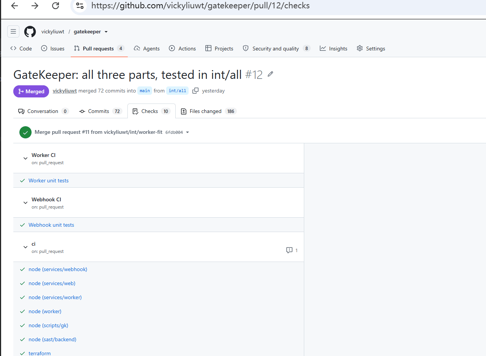

## folders
| folder | what |
| --- | --- |
| `services/webhook` | gk-webhook: HMAC check, job, queue |
| `sast/backend` | course scanner and our fixes |
| `worker` | scan worker: paste jobs and PR jobs, GitHub status |
| `services/web` | the page, gk-submit and gk-results (one image) |
| `infra` | Terraform: core module and one module per part |
| `scripts/gk` | deploy, destroy, smoke and peek-job for every part |
| `docs` | IAM policies for a real AWS account, Part A notes |

## run Locally
```
cd services/web
npm install
npm test
npm run dev
```
then open http://127.0.0.1:9300 (local access code `demo-1234`). a small in-memory worker runs the real course scanner and writes the same shape as the real worker.

## deploy
```
node scripts/gk/deploy.mjs --part web
node scripts/gk/deploy.mjs --part intake --part worker --part web --repo OWNER/DEMO
node scripts/gk/smoke.mjs
node scripts/gk/peek-job.mjs JOB_ID --logs
node scripts/gk/destroy.mjs
```
lab keys go in `~/.aws/credentials`. destroy keeps only the state bucket and the SSM values. then End Lab.
in Learner Lab we send one request at a time. no burst or flood tests there.

## API
| route | function | what |
| --- | --- | --- |
| `POST /webhooks/github` | gk-webhook | GitHub events, HMAC signed |
| `GET /` | gk-results | the page |
| `POST /scans` | gk-submit | paste code (access code in `x-demo-code`), 202 and a jobId |
| `GET /scans` | gk-results | newest 20 PR scans of the demo repo |
| `GET /scans/{jobId}` | gk-results | phase, verdict, counts, try number |
| `GET /scans/{jobId}/report` | gk-results | the masked report |

## Learner Lab notes
- every Lambda runs as LabRole (we can not make roles there), the least privilege policies for gk-submit and gk-results are in `docs/iam`
- no CloudFront in Learner Lab, so `gk-results` serves the page at `GET /`
- no VPC and no NAT on purpose, the worker calls GitHub straight from Lambda
- one request at a time, `gk-submit` capped at 1 and `gk-results` at 2, an alarm at 5 Lambdas at once
- the lab timer is 4 hours and Start Lab again did not reset it for us, so plan the work to fit
- destroy and End Lab at the end of every session
